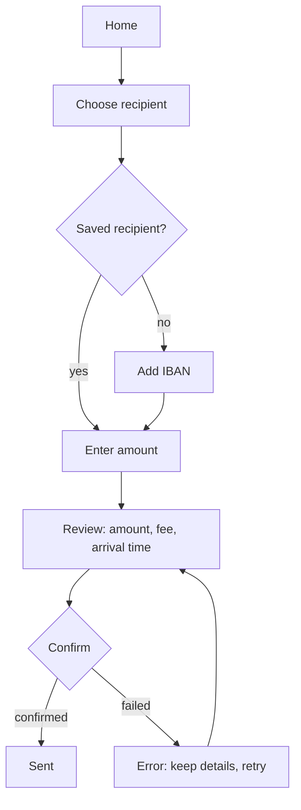

# Mapping flows and IA

Screens are the last step. First decide what happens, in what order, and where things live.

## 1. Task flow

For each main task in the brief:

- **Entry points:** every way a user arrives (home, notification, deep link, search, a shared link).
- **Steps:** one action per step, in the user's words.
- **Decisions:** where the path branches, and on what condition.
- **Errors and recovery:** what can fail at each step and how the user gets back on track.
- **Exits:** success, cancel, and "come back later" with what is saved.

Draw it as a diagram the user can read. Mermaid works in most places:

Count the steps and question each one: can it be removed, merged or defaulted?

## 2. Information architecture

- List the content and features, then group them the way users think about them, not the way the company is organized. When unsure, plan a card sort or a tree test.
- Name groups in the users' words.
- Keep the structure shallow where people navigate often.

## 3. Navigation model

Choose and justify: tab bar, side navigation, hub and spoke, or a single linear flow. Say where each main task starts and how users return to where they were.

## 4. Gate

The user agrees on the flow before screens are designed. Then use `diverging-concepts` or go straight to the design skills, designing one screen per step and every state from `designing-all-states`.
